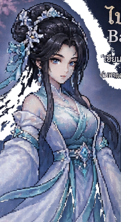
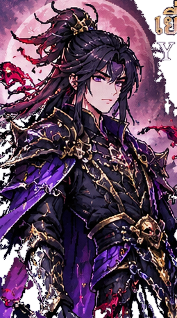
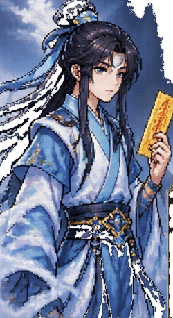
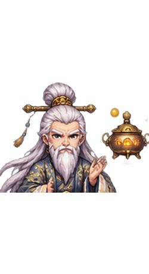

<div align="center">


# มหาแดนพันภพ: ศึกผนึกกระบี่สะบั้นสวรรค์
### *Maha Dan Panpaph: Seal of the Heaven-Severing Sword*

**Top-Down Xianxia Action RPG** พัฒนาด้วย **Godot Engine 4.3** พร้อมโหมดเล่นบนเบราว์เซอร์ (HTML5 Web Demo)

[](https://carinojake.github.io/maha-dan-morta/)
[](https://godotengine.org/)
[](#10-บท-100-ชั้น-campaign-roadmap)
[](#ตัวละครเล่นได้-playable-roster)

---

### 🌐 เล่นทันทีบนเบราว์เซอร์ (ไม่ต้องติดตั้ง)
👉 **[คลิกที่นี่เพื่อเข้าเล่น — https://carinojake.github.io/maha-dan-morta/](https://carinojake.github.io/maha-dan-morta/)**

</div>

---

## จุดเด่นของเกม (Key Features)

- **แคมเปญ 10 บท 100 ชั้น (10 Chapters · 100 Floors):** ตะลุยดันเจี้ยนตั้งแต่ *พรมแดนภพมนุษย์* จนถึง *แท่นมหาผนึกกระบี่สะบั้นสวรรค์* บทละ 10 ห้อง พร้อมมินิบอส บอสใหญ่ และกับดัก/ภัยพิบัติประจำสนามรบ (Chapter Hazards) ที่ไม่ซ้ำกัน
- **7 ตัวละครเซียน-มาร + ระบบปาร์ตี้ 3 คนสลับเรียลไทม์:** เลือกจัดทีม 3 ตัวละคร กดสลับตัวกลางศึกได้ทันที (`1` / `2` / `3` / `Tab`) พร้อมชุดคอสตูมทางเลือก (Alt Costumes) และสกิลเฉพาะตัว `Q / E / R`
- **ควบคุมลื่นไหล รองรับโหมดมือเดียว (One-Handed Friendly):** มีระบบ Auto-Aim, โหมดตีอัตโนมัติ (`C`), Dash อมตะชั่วขณะพร้อมเงาติดตา (`Space`), Hit-stop และ Camera Shake
- **ระบบ Boon & Meta-Upgrade:** เลือกพรเสริมพลังระหว่างทาง, อัปเกรดค่าพลัง (`U`), และเปิดคัมภีร์ข้อมูล (Codex UI) พร้อมระบบเซฟอัตโนมัติ
- **Procedural VFX & SFX:** ระบบเอฟเฟกต์ปราณกระบี่/ค่ายกล (`vfx_studio.gd`) และเสียงสังเคราะห์ (`sfx_synth.gd`)

---

## ตัวละครเล่นได้ (Playable Roster)

| รูป | ตัวละคร | ฉายา | ชุดทางเลือก | สกิล Q / E / R |
| :-: | :--- | :--- | :--- | :--- |
|  | **ไป๋เยว่หลิง** (`bai_yueling`) | เซียนกระบี่เหมันต์ | ชุดคลุมหิมะ | `Q` ปราณกระบี่ 3 แฉก · `E` พายุหนามน้ำแข็ง · `R` แดนเหมันต์หมื่นกระบี่ |
|  | **เยี่ยซางเยี่ย** (`ye_shangye`) | จอมมารโซ่โลหิต | ชุดนักเดินทาง | `Q` โซ่หนามกระชาก · `E` คลื่นเพลิงทมิฬ · `R` ราชันมารกลืนพิภพ |
|  | **ซ่งเหริน** (`song_ren`) | นักพรตยันต์แปดทิศ (ระยะไกล) | ชุดนักเดินทาง | `Q` ยันต์สายฟ้า 5 ทิศ · `E` ค่ายกลแปดทิศ · `R` อัสนีบาตสวรรค์ |
|  | **เฉินซี** (`chen_xi`) | มนุษย์ · กระบี่หักโลหิต | ชุดเกราะศึก | `Q` คมกระบี่หักผ่าเงา · `E` ประกายปราณโลหิต · `R` สังหารโลหิตสะบั้นฟ้า |
|  | **อวี่หาน** (`yu_han`) | เทพ · หอกอัสนีสุริยัน | ชุดนักเดินทาง | `Q` หอกทะลวงอัสนี · `E` หอกอัสนีสุริยัน · `R` ทัณฑ์สวรรค์เก้าชั้นฟ้า |
|  | **จ้าวเหยียน** (`zhao_yan`) | ผู้อาวุโส · เตาโอสถ | ชุดต่อสู้ | `Q` ลูกไฟโอสถ · `E` เปลวโอสถดูดวิญญาณ · `R` มหาเตาหลอมฟื้นกายา |
|  | **เฮยซานเหล่ากุ่ย** (`hei_shan`) | เซียน · พฤกษาพิทักษ์ | ชุดบุปผา | `Q` กลีบสังหารปลิดวิญญาณ · `E` พฤกษาพิทักษ์ทีม · `R` สวนสวรรค์ร้อยบุปผา |

---

## 10 บท 100 ชั้น (Campaign Roadmap)

| บท | ชื่อบท | ภพภูมิ | บอสประจำบท | ภัยพิบัติสนามรบ (Hazard) |
| :-: | :--- | :--- | :--- | :--- |
| 1 | พรมแดนภพมนุษย์ | ภพมนุษย์ (Act I) | ผู้พิทักษ์เตากลืนชีวา | เสาเพลิงโลหิตปะทุจากพื้นโรงหลอม |
| 2 | หอโอสถลับใต้พิภพ | ภพมนุษย์ (Act II) | เฒ่าโอสถมาร ไป๋กู่ | หมอกพิษกัดกร่อน HP |
| 3 | โถงบรรพชนตระกูลเย่ | ภพมนุษย์ (Act III) | ประมุขตระกูลเย่ เย่ซางเย่ | ค่ายกลกระบี่โลหิตลอยล้อมสนาม |
| 4 | รอยแยกด่านอสูรบรรพกาล | ภพอสูร (Act IV) | แม่ทัพอสูร กู่หมิง | แผ่นดินไหวหินงอกพุ่งจากพื้น |
| 5 | ยอดเขาเมฆาคราม | รอยต่อภพมนุษย์-อสูร (Act V) | เจ้าสำนักกระบี่ฟ้า ลู่เทียน | กระแสลมแรงพัดผลักผู้เล่น |
| 6 | หอคอยกลไกหมื่นสวรรค์ | นครกลไก (Act VI) | ปรมาจารย์กลไก เสวียนจี | พื้นฟันเฟืองหมุน + เลเซอร์ค่ายกล |
| 7 | แก่นแท้เตาหลอมบรรพกาล | ใจกลางนครกลไก (Act VII) | จิตวิญญาณเตาหลอมบรรพกาล | ลาวาปราณสูงขึ้นเป็นระยะ |
| 8 | ทวารสวรรค์และสะพานข้ามภพ | พรมแดนภพสวรรค์ (Act VIII) | เทวราชอวี่หาน | สายฟ้าทัณฑ์สวรรค์ผ่าทุก 6 วินาที |
| 9 | ตำหนักกลางบัญชาสวรรค์ | ภพสวรรค์ (Act IX) | ผู้สำเร็จราชการสวรรค์ จ้าวหยาน | โซ่ตรวนกฎสวรรค์ผนึกสกิล |
| 10 | แท่นมหาผนึกกระบี่สะบั้นสวรรค์ | บทสุดท้าย (Act X Finale) | มหาเทพวงล้อชะตากรรมสวรรค์ | สนามรบสลับมิติ 4 ภพภูมิ |

---

## ปุ่มควบคุม (Controls)

| ปุ่ม | การทำงาน |
| :--- | :--- |
| `W A S D` หรือ `ลูกศร` | เคลื่อนที่ |
| `F` | โจมตีปกติ (Basic Attack) |
| `C` | เปิด/ปิด โหมดตีอัตโนมัติ (Auto-Attack) |
| `Space` | วิชาตัวเบา (Dash + อมตะชั่วขณะ) |
| `Q` / `E` / `R` | ใช้สกิลประจำตัวละคร (Skill 1 / Skill 2 / Ultimate) |
| `1` / `2` / `3` หรือ `Tab` | สลับตัวละครในปาร์ตี้ |
| `U` | เปิดหน้าต่างอัปเกรด (Upgrade) |
| `H` | เปิด/ปิด คู่มือการเล่น (Help Overlay) |

---

## วิธีรันโปรเจกต์บนเครื่อง (Local Development)

### 1. รันเวอร์ชันเว็บ (HTML5)
เปิดไฟล์ [`index.html`](index.html) ผ่านเบราว์เซอร์ได้ทันที หรือรันเซิร์ฟเวอร์จำลองในเครื่อง:
```bash
python3 -m http.server 8080
# เปิด http://localhost:8080
```

### 2. รันเวอร์ชัน Godot 4.3+
1. ติดตั้ง [Godot Engine 4.3+](https://godotengine.org/)
2. โคลนโปรเจกต์แล้วเปิด `project.godot`:
```bash
git clone https://github.com/carinojake/maha-dan-morta.git
cd maha-dan-morta
godot --path .
```

### 3. รันชุดทดสอบอัตโนมัติ (Headless E2E Tests)
```bash
godot --headless --path . -s res://tests/test_dark_jade_e2e.gd
godot --headless --path . -s res://tests/test_7heroes_costumes_e2e.gd
godot --headless --path . -s res://tests/test_100_floors_e2e.gd
```

---

## โครงสร้างโปรเจกต์ (Project Structure)

```text
maha-dan-morta/
├── index.html                  # เวอร์ชันเว็บแบบไฟล์เดียว (โฮสต์บน GitHub Pages)
├── project.godot               # ไฟล์ตั้งค่า Godot 4.3 (Main Scene: dark_jade_dungeon.tscn)
├── scenes/                     # ซีนดันเจี้ยน, ตัวละคร, ไอเทม และฉากต่างๆ
├── scripts/                    # โลจิกเกมหลัก (dark_jade_dungeon, hero_data, chapter_data, vfx_studio, sfx_synth)
├── singletons/                 # ระบบ Autoload (Globals, Music, Dialogs, Inventory, Quest)
├── assets/                     # สไปรต์ตัวละคร 7 ฮีโร่, มอนสเตอร์/บอส, ฉาก และ VFX
├── tests/                      # ชุดทดสอบ E2E อัตโนมัติ (100 ชั้น, 7 ฮีโร่, ระบบ Meta)
└── tools/                      # สคริปต์เครื่องมือช่วยพัฒนา
```

---

## กิตติกรรมประกาศ (Credits & License)

- โครงสร้างเริ่มต้นต่อยอดจาก `top-down-action-rpg-template` (MIT License — ดูรายละเอียดใน [`LICENSE`](LICENSE))
- เอฟเฟกต์เสียงประกอบบางส่วนจาก freesound.org และดนตรีประกอบโดย Aaron Krogh
